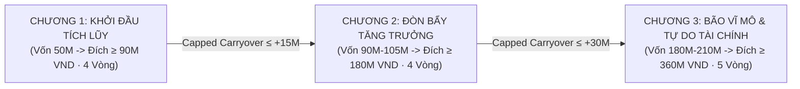

# AGENTS.md — Hướng Dẫn Tác Nhân AI: PlayBoard (Cờ Tỷ Phú Đầu Tư Tài Chính 3 Chương & Hệ Sinh Thái Gemini 4)

Tài liệu này là **nguồn chân lý tối cao (Single Source of Truth)** định nghĩa vai trò, ranh giới kiến trúc, hệ thống thử thách tài chính, ma trận điều phối Model (Gemini 4 Series) và quy chuẩn cổng chất lượng dành cho toàn bộ các Agent (Antigravity / Subagents / Workflow Workers) làm việc cùng **Phát (Owner & Lead Game Developer / Kiến Trúc Sư Trưởng)** trong dự án độc lập **PlayBoard**.

---

## 1. Bối Cảnh Dự Án & Quyền Sở Hữu Độc Lập

- **Dự án:** **PlayBoard** (`https://github.com/philipsgn/PlayBoard.git`) — Game Bàn Cờ Tỷ Phú Tích Hợp Đầu Tư Tài Chính Thực Chiến 3 Chương:
  - **Chương 1 — Khởi Đầu Tích Lũy (`50M → 90M VND`, 4 Vòng = 4 Quý):** Bàn cờ 18 ô (`B18`), quản lý 5 kênh tài sản (Tiền mặt, Tiết kiệm kỳ hạn, Cổ phiếu 3 ngành, Trái phiếu tín dụng V2.5, Vàng trú ẩn, Tiệm kinh doanh), giữ kỷ luật đệm khẩn cấp `10.000.000 VND`.
  - **Chương 2 — Đòn Bẩy Tăng Trưởng (`90M+ → 180M VND`, 4 Vòng):** Kế thừa vốn thặng dư có trần (`Capped Carryover ≤ +15M`), đối mặt **Lạm phát sinh hoạt phí lũy tiến** (`+1M/vòng`), quy mô biến cố `1.5x` và **Thẻ Tình Huống Hệ Quả Trễ (Delayed Consequence Dilemmas)** (Bảo hiểm Phòng vệ vs. Rủi ro biến cố; Cắt giảm chi phí ngắn hạn vs. Sụt giảm 35% dòng tiền kinh doanh kỳ sau).
  - **Chương 3 — Bão Vĩ Mô & Tự Do Tài Chính (`180M+ → 360M VND`, 5 Vòng chu kỳ kinh tế):** Kế thừa vốn thặng dư có trần (`Capped Carryover ≤ +30M`), mở hạn mức vay đòn bẩy `120.000.000 VND` kèm **Cơ chế Call Margin Cưỡng Chế** (tự động thanh lý Cổ phiếu/Vàng chịu phạt `5%` khi tỷ lệ `Nợ / Tài sản đảm bảo thanh khoản > 60%`).
- **Loại bỏ hoàn toàn:** Toàn bộ màn game *Quản lý pha cà phê (Coffee Shop Simulator / Cafe3D)* đã được gỡ bỏ vĩnh viễn để tập trung 100% chiều sâu vào lõi **Cờ Tỷ Phú Đầu Tư Tài Chính**.
- **Chủ sở hữu & Kiến trúc sư trưởng:** **Phát (Owner & Lead Game Developer)**.
- **Ranh giới quyền hạn:** **100% FULL READ/WRITE TRÊN TOÀN BỘ CODEBASE**.

---

## 2. Chuẩn Thiết Kế, Đồ Họa & Trải Nghiệm Người Chơi

1. **Thiết kế Mobile-First:** Canvas chuẩn `1080 × 2400 px` (Board viewport `940 × 1672 px`), tỷ lệ 9:20 / 20:9, tối ưu thao tác một ngón tay cái.
2. **Phông chữ chủ đạo:** **Fredoka** (Medium 500, SemiBold 600, Bold 700) hỗ trợ 100% tiếng Việt có dấu.
3. **Phong cách Đồ họa 2.5D Hybrid Isometric Diorama + Tactile Financial UI:**
   - Mặt bàn cờ Isometric 2.5D sắc nét kết hợp Nhân vật 3D (`Character3D.tsx`), Xúc xắc 3D (`Dice3D.tsx`) và lớp Diorama 3D bán trong suốt (`ChapterStage.tsx` hiển thị Chồng xu tiền mặt, Xích nợ cảnh báo, Cờ đích và Ánh sáng môi trường `LightingRig` theo vòng & chương).
   - Giao diện thẻ quyết định Holographic, Cảnh báo nhịp tim đỏ khi thủng đệm tiền mặt (`.danger-zone-vignette`), và bảng phân tích AI Coach cuối màn.
4. **Nguyên tắc Tài chính Chân thật (Zero Float Drift):**
   - Mọi số liệu tiền tệ là **số nguyên VND** (`Math.round()` / `Math.floor()`), phân cách dấu chấm rõ ràng (`90.000.000 ₫`).
   - Chiến thắng xét trên **Nguồn Huy Động Hợp Lệ (`lawfulProceeds` / `liquidatableFunds`)** sau khi trừ phí bán, chênh lệch giá vàng (`3%`), nợ gốc + lãi vay (`10%/vòng`), và không tính Tiệm kinh doanh chưa thanh lý hoặc lãi tiết kiệm chưa đáo hạn.

---

## 3. Kiến Trúc 3 Chương Bàn Cờ & 6 Bẫy Tài Chính Cốt Lõi



### 6 Nhóm Khúc Mắc & Bẫy Tài Chính Buộc Người Chơi Phải Giải Đố:
1. **Bẫy Thanh Khoản & Phạt Thanh Lý Cưỡng Bức:** Rút tiết kiệm trước hạn mất 100% lãi cả sổ; Tiệm kinh doanh khóa thanh khoản ngoài ô Kinh doanh; Vay nóng chịu lãi phạt 10%/vòng.
2. **Bẫy Lãi Suất Cao & Vỡ Nợ Trái Phiếu (Credit Risk V2.5):** Trái phiếu *Bứt Phá* trả coupon cao hơn *An Tâm* nhưng dễ bị chậm trả (`delayed`) hoặc vỡ nợ (`defaulted`) khi gặp cú sốc `Tín dụng thắt chặt`.
3. **Bẫy Thời Điểm Chi Phí Cơ Hội:** Mua khóa học tăng lương hoặc gửi tiết kiệm kỳ hạn 3 vòng quá muộn ở Vòng 3–4 sẽ không kịp thu hồi vốn trước khi kết thúc ván.
4. **Bẫy FOMO Đu Đỉnh & Đảo Chiều Vĩ Mô:** Tin dự báo đầu vòng có độ bất định; cần phòng vệ chéo (Hedging) giữa Cổ phiếu/Kinh doanh và Vàng/Tiết kiệm.
5. **Bài Toán Quyết Toán Vòng Cuối (`lawfulProceeds`):** Tiệm kinh doanh chưa bán ở vòng cuối tính bằng `0 VND` thanh khoản hợp lệ.
6. **Lạm Phát Lũy Tiến, Hệ Quả Trễ & Call Margin (Chương 2 & 3):** Sinh hoạt phí tăng qua mỗi vòng; quyết định cắt giảm bảo trì làm hụt 35% doanh thu vòng sau; tỷ lệ đòn bẩy `Nợ / Tài sản thanh khoản > 60%` kích hoạt **Call Margin cưỡng chế bán tài sản chịu phạt 5%**.

---

## 4. Ma Trận Phân Bổ Model (Gemini 4 Series) & Hệ Thống 4 Subagents

### 4.1. Chiến Lược Chọn Model Trong Antigravity

| Nhiệm vụ & Giai đoạn | Model Khuyên Dùng (UI Selector) | Subagent / Workflow Tier (`model`) | Lý do kỹ thuật |
| :--- | :--- | :--- | :--- |
| **Lập Kế Hoạch (`/plan`, `/grill-me`) & Điều Phối Đa Tác Nhân (`run_workflow`, `/teamwork`)** | **`Orchestrator (Neon)`** hoặc **`Orchestrator (Carbon)`** | `inherit` / `pro` | Tối ưu cho việc tách nhánh nhiệm vụ, kiểm soát phụ thuộc giữa Engine, UI, 3D và QA. |
| **Thiết Kế Toán Kinh Tế, State Machine (`src/game/**`), Bẫy Tài Chính & Cân Bằng Xác Suất** | **`Gemini 4 Neon (Medium)`** hoặc **`Gemini 4 Carbon (Medium)`** | `pro` / `inherit` | Năng lực suy luận toán học chính xác tuyệt đối, bảo toàn 100% tính tất định (Deterministic Seed RNG). |
| **Thực Thi Code UI/CSS (`mobile_app/**`), Refactor Component, Viết Unit Tests** | **`Gemini 4 Hydrogen (Medium)`** | `flash` / `inherit` | Thế hệ Gemini 4 tốc độ cao, thực thi code nhanh và tiết kiệm quota khi đã có spec rõ ràng. |
| **Kiểm Tra Chính Tả Tiếng Việt, Quét File, Chạy Lệnh Test & Build Verification** | **`Gemini 4 Hydrogen (Medium)`** | `flash_lite` / `flash` | Tác vụ kiểm định tự động tốc độ cao. |

*(Lưu ý: `Gemini 4 Argon` và `Gemini 3.8 Flash` đang ở trạng thái `Leaving Soon`, chỉ dùng dự phòng khi các model `Neon / Carbon / Hydrogen` quá tải).*

### 4.2. Quy Chế 4 Subagents Chuyên Biệt ([`docs/AGENTS_SOP.md`](./docs/AGENTS_SOP.md))

1. **`financial-engine-worker` (Logic & Toán Kinh Tế 3 Chương):** Phụ trách `src/game/**`, `src/data/**`. Thuần TypeScript, số nguyên VND, không import React/DOM/Three.js.
2. **`board-diorama-3d-worker` (Đồ Họa 2.5D Isometric & Stage3D Diorama):** Phụ trách `mobile_app/src/features/stage3d/**`, `BoardView.tsx`, `Character3D.tsx`, `Dice3D.tsx`. Khóa 60 FPS, bắt buộc `dispose()` WebGL khi unmount.
3. **`tactile-ui-worker` (Giao Diện Mobile-First & Thẻ Quyết Định):** Phụ trách `mobile_app/src/components/**`, `src/components/**`. Canvas `1080 × 2400 px`, font Fredoka tiếng Việt.
4. **`qa-gatekeeper-worker` (Người Gác Cổng Chất Lượng):** Quyền phủ quyết tuyệt đối; đảm bảo 100% unit tests + UI diagnostics + Web/Mobile build pass.

---

## 5. Hệ Thống Rules & Skills Trong `.agents/`

- **Rules (`.agents/rules/`):**
  - [`.agents/rules/engine-finance-rules.md`](./.agents/rules/engine-finance-rules.md): Quy tắc toán kinh tế, 3 Chương bàn cờ, Call Margin, Hệ quả trễ & Deterministic RNG.
  - [`.agents/rules/app-ui-rules.md`](./.agents/rules/app-ui-rules.md): Quy chuẩn Mobile-First 1080×2400, Fredoka, 2.5D Diorama & WebGL Disposal.
  - [`.agents/rules/ai-coach-rules.md`](./.agents/rules/ai-coach-rules.md): Quy tắc AI Coach grounding theo bằng chứng thực tế của ván cờ.
  - [`.agents/rules/workflow.md`](./.agents/rules/workflow.md): Quy trình 5 bước Atomic Scope Isolation & Ma trận Model Gemini 4.
- **Skills (`.agents/skills/`):**
  - [`.agents/skills/qa-gatekeeper/SKILL.md`](./.agents/skills/qa-gatekeeper/SKILL.md): Runbook chạy 4 cổng kiểm định chất lượng bắt buộc.
  - [`.agents/skills/financial-balance-sim/SKILL.md`](./.agents/skills/financial-balance-sim/SKILL.md): Runbook kiểm tra cân bằng toán học và tỷ lệ thắng của 3 Chương Bàn Cờ.

---

## 6. Cổng Kiểm Tra Chất Lượng Tuyệt Đối (Zero-Regression Policy)

Trước khi kết thúc bất kỳ lượt nâng cấp nào hoặc tạo commit mới, Agent bắt buộc phải chạy 4 lệnh kiểm tra sau và đảm bảo **100% PASS**:

```sh
npm test                                                                        # Toàn bộ Unit tests engine (100% pass)
node --experimental-strip-types --test scripts/diagnostics/mobile-final-ui.test.ts # Kiểm tra hợp đồng UI Mobile (8/8 pass)
npm run build                                                                   # Build web production bundle
npm --prefix mobile_app run build                                               # Build mobile production bundle
```
