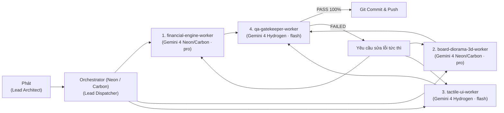

# QUY CHẾ VẬN HÀNH & GIAO VIỆC CHO ĐỘI NGŨ AGENTS (SOP)
## Standard Operating Procedures (SOP) & Gemini 4 Model Routing (2026 Edition)
**Kiến trúc sư trưởng:** Phát (Owner & Lead Game Developer)  
**Dự án:** PlayBoard — Game Bàn Cờ Tỷ Phú Tích Hợp Đầu Tư Tài Chính 3 Chương  

---

## 1. MỤC ĐÍCH & NGUYÊN TẮC TỐI THƯỢNG

Tài liệu này xác lập **Quy chuẩn Vận hành Tiêu chuẩn (SOP)** và **Chiến lược Phân bổ Model Gemini 4** dành cho toàn bộ các Tác nhân AI (Antigravity / Subagents / Workflow Workers) tham gia phát triển dự án PlayBoard.
> **Nguyên tắc tối thượng:** Mọi Agent phải thực thi công việc theo đúng vai trò chuyên môn hóa, tuân thủ ranh giới kiến trúc, chỉ tập trung vào lõi **Cờ Tỷ Phú Đầu Tư Tài Chính 3 Chương** và đảm bảo **Zero Regression (100% bài test pass)**.

---

## 2. MA TRẬN PHÂN BỔ MODEL (GEMINI 4 SERIES & ORCHESTRATOR)

Khi lập kế hoạch và thực thi code trên Antigravity, sử dụng phân tầng Model sau để đạt hiệu suất suy luận và tốc độ cao nhất:

| Tầng Công Việc | Model Trên Giao Diện Antigravity | Tier Khi Gọi `invoke_subagent` / `run_workflow` | Phạm Vi Áp Dụng |
| :--- | :--- | :--- | :--- |
| **Tầng 1: Điều Phối & Kiến Trúc (`/plan`, `/grill-me`, `run_workflow`)** | **`Orchestrator (Neon)`** hoặc **`Orchestrator (Carbon)`** | `inherit` / `pro` | Chia nhỏ bài toán lớn thành các pha độc lập (Engine / 3D / UI / QA) và điều phối đa tác nhân song song. |
| **Tầng 2: Toán Kinh Tế, Luật Cờ Tỷ Phú & Cân Bằng Game** | **`Gemini 4 Neon (Medium)`** hoặc **`Gemini 4 Carbon (Medium)`** | `pro` / `inherit` | Thiết kế công thức tài chính (`src/game/**`), Bẫy thanh khoản, Trái phiếu V2.5, Hệ quả trễ, Call Margin và Simulation. |
| **Tầng 3: Thực Thi Giao Diện, Refactor & Viết Unit Tests** | **`Gemini 4 Hydrogen (Medium)`** | `flash` / `inherit` | Viết component React 19 (`mobile_app/src/components/**`), CSS, dọn dẹp file thừa và bổ sung test cases theo spec. |
| **Tầng 4: Kiểm Định Nhanh, Audit Tiếng Việt & Chạy Build Gate** | **`Gemini 4 Hydrogen (Medium)`** | `flash_lite` / `flash` | Quét lỗi chính tả, kiểm tra đường dẫn asset và chạy 4 lệnh cổng kiểm thử chất lượng. |

---

## 3. PHÂN ĐỊNH 4 VAI TRÒ SUBAGENT WORKER CHUYÊN BIỆT

### 3.1. Subagent 1: `financial-engine-worker` (Cỗ Máy Toán Kinh Tế & Luật 3 Chương)
- **Trách nhiệm:** Phát triển và bảo trì `src/game/**` và `src/data/**` (Luật B18, Cấu hình 3 Chương `50M->90M->180M->360M`, Lạm phát lũy tiến, Hệ quả trễ, Đòn bẩy & Call Margin, AI Coach Facts).
- **Ranh giới nghiêm ngặt:**
  - ❌ Tuyệt đối không import React, DOM, CSS hay Three.js.
  - ❌ Tuyệt đối không để phát sinh số thực lẻ; mọi giá trị tiền tệ phải làm tròn số nguyên VND (`Math.round()`).
  - ❌ Bảo toàn 100% tính tương thích của các snapshot lịch sử và bộ test B18.

### 3.2. Subagent 2: `board-diorama-3d-worker` (Đồ Họa 2.5D Isometric & Stage3D Diorama)
- **Trách nhiệm:** Phát triển `mobile_app/src/features/stage3d/**`, `BoardView.tsx`, `Character3D.tsx`, `Dice3D.tsx`.
- **Ranh giới nghiêm ngặt:**
  - ❌ Khóa cứng hiệu năng 60 FPS trên mobile (`pixelRatio <= 1.5`, tắt shadow map nặng).
  - ❌ Bắt buộc `.dispose()` toàn bộ Geometry, Material, Texture và `renderer.forceContextLoss()` khi unmount.
  - ❌ Không can thiệp vào công thức tiền tệ; chỉ đọc state qua `extractVisualMetaphors(game)`.

### 3.3. Subagent 3: `tactile-ui-worker` (Giao Diện Mobile-First & Thẻ Quyết Định Tài Chính)
- **Trách nhiệm:** Phát triển `mobile_app/src/components/**`, `mobile_app/src/game/**`, `src/components/**`.
- **Ranh giới nghiêm ngặt:**
  - ❌ Khung hiển thị chuẩn `1080 × 2400 px`, font chữ **Fredoka** tiếng Việt có dấu 100%.
  - ❌ Hiển thị minh bạch mọi chi phí, phí giao dịch, spread vàng, lãi mất khi rút tiết kiệm sớm và cảnh báo đệm khẩn cấp / Call Margin.

### 3.4. Subagent 4: `qa-gatekeeper-worker` (Người Gác Cổng Chất Lượng & Chặn Hồi Quy)
- **Trách nhiệm:** Chạy và kiểm duyệt độc lập toàn bộ hệ thống test suite và build pipeline.
- **Quy trình nghiệm thu bắt buộc (Verification Checklist):**
  1. `npm test`: **100% Unit tests PASS**.
  2. `node --experimental-strip-types --test scripts/diagnostics/mobile-final-ui.test.ts`: **8/8 UI contract tests PASS**.
  3. `npm run build`: Web production bundle thành công.
  4. `npm --prefix mobile_app run build`: Mobile production bundle thành công.
