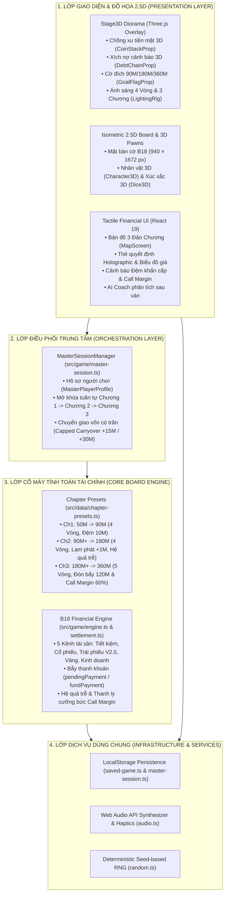
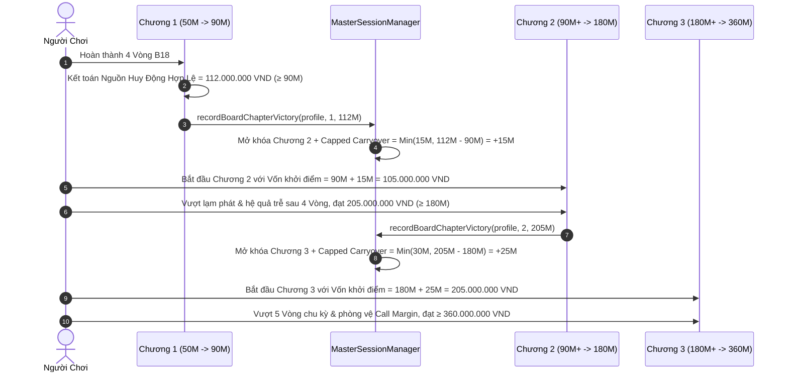

# PLAYBOARD: MASTER SYSTEM ARCHITECTURE DOCUMENT (SAD)
## Kiến Trúc Hệ Thống Tổng Thể Toàn Diện Cho Game Bàn Cờ Tỷ Phú Đầu Tư Tài Chính 3 Chương
**Kiến trúc sư trưởng:** Phát (Owner & Lead Game Developer)  
**Dự án:** PlayBoard (`https://github.com/philipsgn/PlayBoard.git`)  
**Tiêu chuẩn:** Mobile-First Canvas 1080 × 2400 px · 2.5D Hybrid Isometric Diorama (Three.js) + React 19 · TypeScript  

---

## 1. TỔNG QUAN KIẾN TRÚC HỆ THỐNG (SYSTEM OVERVIEW)

PlayBoard là ứng dụng game bàn cờ tỷ phú giáo dục đầu tư tài chính đa cấp độ trên nền tảng Mobile Web / PWA. Ứng dụng kết hợp giữa cỗ máy mô phỏng toán kinh tế tất định (Deterministic Seed RNG, 100% số nguyên VND) và trải nghiệm thị giác **2.5D Hybrid Isometric Diorama + Tactile Financial UI**.

### 1.1. Sơ Đồ Khối Kiến Trúc Phân Tầng (Layered Architecture)

---

## 2. LỚP ĐIỀU PHỐI TRUNG TÂM (`MasterSessionManager`)

`MasterSessionManager` (`src/game/master-session.ts`) quản lý tiến trình xuyên suốt 3 Chương Bàn Cờ mà vẫn giữ tính cân bằng toán học thông qua cơ chế **Capped Carryover**:

---

## 3. PIPELINE ĐỒ HỌA 2.5D HYBRID DIORAMA (`ChapterStage`)

1. **Tách biệt hoàn toàn khỏi Logic Engine:** `extractVisualMetaphors(game)` (`mobile_app/src/features/stage3d/bindings/stateBindings.ts`) là một pure adapter đọc `GameState` và xuất ra chiều cao chồng xu, số mắt xích nợ, tỷ lệ tiến độ cờ đích và thời gian ánh sáng trong ngày.
2. **Giải phóng bộ nhớ WebGL bắt buộc:** Khi rời bàn cờ, `ChapterStage.tsx` hủy `requestAnimationFrame` và gọi `.dispose()` trên toàn bộ Prop (`CoinStackProp`, `DebtChainProp`, `GoalFlagProp`, `LightingRig`), Geometry, Material và `renderer.forceContextLoss()`.

---

## 4. BẢO MẬT & KIỂM SOÁT TÍNH TOÀN VẸN DỮ LIỆU

1. **Chống Sai Số Số Thực (Zero Floating-Point Drift):** Toàn bộ phép tính giá cổ phiếu, phí giao dịch, spread vàng, lãi tiết kiệm, coupon trái phiếu và phạt Call Margin đều làm tròn về số nguyên VND (`Math.round()`).
2. **Deterministic Seed-based Replay:** Cùng một chuỗi hạt giống (`seed`) và chuỗi quyết định của người chơi sẽ luôn tái hiện chính xác 100% lịch sử giá và kết quả ván cờ.
