# HỆ SINH THÁI TÀI LIỆU THIẾT KẾ GAME PLAYBOARD (CỜ TỶ PHÚ ĐẦU TƯ TÀI CHÍNH 3 CHƯƠNG)
### Chuẩn Mực Game Design, Player Handbook, Design System & Tech Architecture
**Chủ sở hữu & Giám đốc Dự án:** Phát (Owner & Lead Game Developer)  
**Codebase:** `https://github.com/philipsgn/PlayBoard.git`  

---

## 1. Bản Đồ Tổng Quan 3 Chương Bàn Cờ Tỷ Phú Tài Chính

PlayBoard là game bàn cờ tỷ phú tích hợp đầu tư tài chính thực chiến trên nền tảng Mobile Web / PWA (Canvas chuẩn `1080 × 2400 px`, Typography Fredoka tiếng Việt). Người chơi đi qua 3 Chương Bàn Cờ với quy mô vốn, độ phức tạp danh mục và áp lực vĩ mô tăng dần:

```mermaid
flowchart LR
    subgraph C1["CHƯƠNG 1: KHỞI ĐẦU TÍCH LŨY<br/>(50M -> 90M VND · 4 Vòng)"]
        C1A["5 Kênh tài sản cơ bản"]
        C1B["Đệm khẩn cấp 10M"]
        C1C["Phạt rút tiết kiệm sớm"]
    end

    subgraph C2["CHƯƠNG 2: ĐÒN BẨY TĂNG TRƯỞNG<br/>(90M+ -> 180M VND · 4 Vòng)"]
        C2A["Lạm phát sinh hoạt +1M/vòng"]
        C2B["Thẻ tình huống Hệ quả trễ"]
        C2C["Rủi ro tín dụng Trái phiếu V2.5"]
    end

    subgraph C3["CHƯƠNG 3: BÃO VĨ MÔ & TỰ DO TÀI CHÍNH<br/>(180M+ -> 360M VND · 5 Vòng)"]
        C3A["Vay đòn bẩy 120M"]
        C3B["Cưỡng chế Call Margin (> 60%)"]
        C3C["Quyết toán Huy động hợp lệ 360M"]
    end

    C1 -->|Capped Carryover ≤ +15M| C2
    C2 -->|Capped Carryover ≤ +30M| C3
```

---

## 2. Danh Mục Thư Mục & Tài Liệu Chi Tiết

### 📘 [Chương 1: Khởi Đầu Tích Lũy (`50M → 90M VND`)](./chapter_1_boardgame/)
- 📄 [01_GAME_DESIGN_DOCUMENT.md](./chapter_1_boardgame/01_GAME_DESIGN_DOCUMENT.md): Game Mechanics, 18 ô bàn cờ B18, 4 Quý vĩ mô 2026, Bẫy thanh khoản cơ bản, Điều kiện thắng 90M.
- 📄 [02_PLAYER_HANDBOOK.md](./chapter_1_boardgame/02_PLAYER_HANDBOOK.md): Sổ tay người chơi, luật từng ô cờ, cẩm nang phân bổ vốn và giữ đệm tiền mặt 10M.
- 📄 [03_DESIGN_SYSTEM.md](./chapter_1_boardgame/03_DESIGN_SYSTEM.md): Design tokens, 2.5D Hybrid Isometric Diorama (`ChapterStage`), HUD, Modals giao dịch.
- 📄 [04_TECH_ARCHITECTURE.md](./chapter_1_boardgame/04_TECH_ARCHITECTURE.md): Data models (`GameState`, `Portfolio`), Deterministic RNG, kiểm thử tự động.

### 📈 [Chương 2: Đòn Bẩy Tăng Trưởng (`90M+ → 180M VND`)](./chapter_2_leverage_growth/)
- 📄 [01_GAME_DESIGN_DOCUMENT.md](./chapter_2_leverage_growth/01_GAME_DESIGN_DOCUMENT.md): Kế thừa Capped Carryover (`≤ +15M`), Lạm phát sinh hoạt phí lũy tiến (`8M + 1M/vòng`), Thẻ Tình Huống Hệ Quả Trễ (Bảo hiểm Phòng vệ vs. Rủi ro biến cố; Cắt giảm chi phí bảo trì vs. Giảm 35% doanh thu tiệm kinh doanh), Đích 180M.

### ⚡ [Chương 3: Bão Vĩ Mô & Tự Do Tài Chính (`180M+ → 360M VND`)](./chapter_3_macro_freedom/)
- 📄 [01_GAME_DESIGN_DOCUMENT.md](./chapter_3_macro_freedom/01_GAME_DESIGN_DOCUMENT.md): Kế thừa Capped Carryover (`≤ +30M`), Chu kỳ kinh tế 5 Vòng, Lạm phát sinh hoạt phí (`12M + 1.5M/vòng`), Hạn mức vay đòn bẩy `120M`, Cơ chế Cưỡng chế Call Margin (`Nợ / Tài sản thanh khoản > 60%`), Đích 360M.
