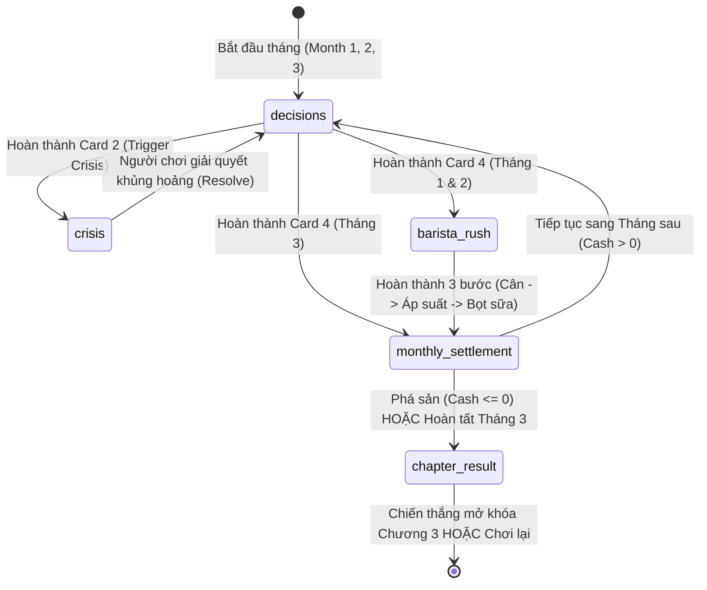

# CHƯƠNG 2: KHỞI NGHIỆP QUÁN CÀ PHÊ (COFFEE SHOP SIMULATOR)
## TÀI LIỆU KIẾN TRÚC KỸ THUẬT & MÔ HÌNH DỮ LIỆU (TECH ARCHITECTURE)
**Môi trường:** TypeScript 5.6+, React 19, Immutable State Reducer, Web Audio API  
**Mã nguồn Engine:** `src/game/chapter2/`  
**Mã nguồn Mobile UI:** `mobile_app/src/components/Coffee*.tsx`, `ChibiCustomerBar.tsx`, `BaristaRushMiniGame.tsx`  
**Phiên bản:** 2.0 (Chuẩn Vận Hành F&B Thực Tế & Cozy Tycoon 2026)  
**Tác giả:** Senior Game Manager Creator 2026  

---

## 1. MÔ HÌNH DỮ LIỆU CHUẨN MỰC (DATA CONTRACTS)

### 1.1. Trạng Thái Vận Hành Quán (`CoffeeShopState`)
```typescript
export interface CoffeeShopState {
  month: 1 | 2 | 3;
  cash: number;                  // Tiền mặt lưu động hiện có (VND)
  capitalInvested: number;       // Vốn chuẩn ban đầu (90.000.000 VND)
  bonusRunwayCash: number;       // Quỹ dự phòng thặng dư chuyển từ Chương 1
  equipmentValue: number;        // Giá trị tài sản máy móc thiết bị
  dailyCupsSold: number;         // Lượng ly bán ra trung bình mỗi ngày
  averageOrderValue: number;     // Giá bán trung bình mỗi ly (35.000 VND)
  customerSatisfaction: number;  // Độ hài lòng khách hàng (0..100)
  fixedCosts: FixedCostBreakdown;
  variableCostRatio: number;     // Tỷ lệ biến phí trên doanh thu (ví dụ 0.30 = 30%)
  
  // Tiến trình quyết định & P&L
  activeDecisions: string[];     // Danh sách ID các quyết định đã chọn
  currentCardIndex: number;      // 0..3: Vị trí thẻ quyết định trong tháng
  monthlyPnL: MonthlyPnLStatement[];
  
  // Biến cố khủng hoảng & Mini-game
  activeCrisis?: CoffeeCrisisEvent | null;
  resolvedCrisisIds: string[];
  baristaRushCompleted?: boolean;
  lastRushTip?: number;
  
  // State Machine Phase
  phase: 'briefing' | 'decisions' | 'crisis' | 'barista_rush' | 'monthly_settlement' | 'chapter_result';
  outcome?: CoffeeShopOutcome;
}
```

### 1.2. Thẻ Biến Cố Khủng Hoảng (`CoffeeCrisisEvent`)
```typescript
export interface CrisisOption {
  id: 'A' | 'B' | 'C';
  label: string;
  cashImpactImmediate: number;   // Tiền mặt tức thời (VND)
  dailyCupsDelta: number;        // Thay đổi lượng ly bán ra mỗi ngày
  satisfactionDelta: number;     // Thay đổi độ hài lòng khách hàng (-100..+100)
  takeawayLesson: string;        // Bài học thực chiến
}

export interface CoffeeCrisisEvent {
  id: string;
  monthTarget?: 1 | 2 | 3;
  title: string;
  context: string;
  urgencyLevel: 'high' | 'critical' | 'opportunity';
  options: CrisisOption[];
}
```

---

## 2. STATE MACHINE VÒNG ĐỜI THÁNG & ĐIỀU PHỐI (MONTHLY LIFECYCLE)



---

## 3. THUẬT TOÁN P&L & TÍNH ĐIỂM HÒA VỐN (`src/game/chapter2/pnl.ts`)

```typescript
export function generateMonthlyPnL(state: CoffeeShopState): MonthlyPnLStatement {
  const daysInMonth = 30;
  const revenue = Math.round(state.dailyCupsSold * state.averageOrderValue * daysInMonth);
  const cogs = Math.round(revenue * state.variableCostRatio);
  const grossProfit = revenue - cogs;
  const fixedCosts = calculateTotalFixedCosts(state.fixedCosts);
  const netProfit = grossProfit - fixedCosts;
  const cashEnding = Math.round(state.cash + netProfit);
  const breakEvenCupsDaily = calculateBreakEvenCupsDaily(
    fixedCosts,
    state.averageOrderValue,
    state.variableCostRatio
  );

  return {
    month: state.month,
    revenue,
    cogs,
    grossProfit,
    fixedCosts,
    netProfit,
    cashEnding,
    breakEvenCupsDaily,
    isBreakEven: netProfit >= 0,
  };
}
```

---

## 4. TỔNG HỢP ÂM THANH PROCEDURAL WEB AUDIO (`mobile_app/src/utils/audio.ts`)

Toàn bộ âm thanh F&B được tạo động bằng Web Audio API, không tốn tài nguyên tải asset mạng:
1. `playEspressoMachine()`: Máy bơm 85-110Hz + hơi nước lọc dải thông bandpass 1400Hz.
2. `playReceiptPrint()`: Chuỗi 5 xung in kim 1900-2150Hz nhịp nhàng 45ms.
3. `playCashDrawer()`: Hòa âm chuông kép 1350Hz & 1750Hz kèm rung Haptic.
4. `playGrinderSound()`: Máy xay hạt cà phê rào rào lọc lowpass 600-1100Hz.
5. `playSteamWand()`: Vòi hơi sục sữa béo ngậy lọc bandpass 1800Hz.
6. `playDingSuccess()`: Chuông quầy bar pha chế xong C7 2093Hz tinh khiết.
7. `playCrisisAlarm()`: Còi báo động sóng răng cưa 580-850Hz.
8. `playTipJingle()`: Chuỗi nốt nhạc đồng xu leng keng 1568Hz - 2093Hz - 2349Hz.

---

## 5. TÍCH HỢP HỆ THỐNG VỚI MASTERSESSIONMANAGER (`src/game/master-session.ts`)

1. **Chuyển giao vốn (Carryover):**
   - Vốn chuẩn: `startingCapitalForCh2 = 90.000.000 VND`.
   - Quỹ dự phòng thặng dư: `bonusRunwayCash = Max(0, Chapter1NetWorth - 90.000.000 VND)`.
2. **Mở khóa Chương 3:**
   - Khi chiến thắng Chương 2 (Hòa vốn Tháng 3 & Tiền mặt $> 0$), hệ thống tự động thiết lập:
     ```typescript
     profile.unlockedChapters.chapter3 = true;
     profile.carryoverFromChapter2 = {
       finalMonthlyCashflow: outcome.finalNetProfit,
       accumulatedCash: state.cash,
       brandReputation: state.customerSatisfaction,
       completedAt: Date.now(),
     };
     ```
